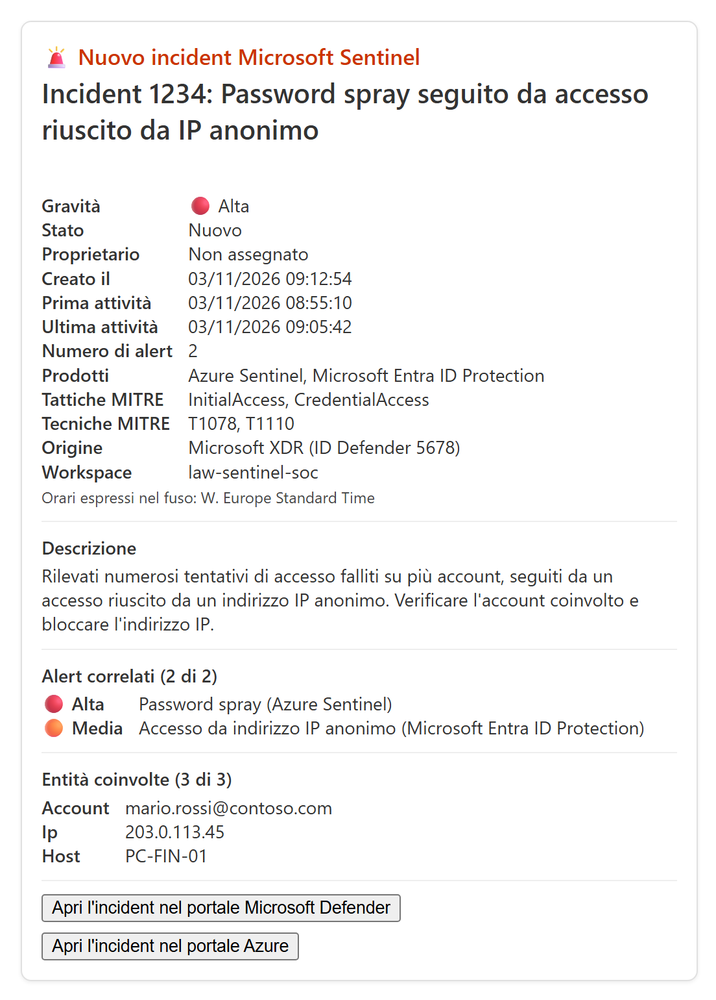

# Notifica Microsoft Teams per i nuovi incident di Microsoft Sentinel

Un playbook (Logic App) per Microsoft Sentinel. A ogni nuovo incident invia su **Microsoft Teams** una **Adaptive Card** con i dettagli e con un pulsante che apre **direttamente l'incident nel portale Microsoft Defender**.

[](https://portal.azure.com/#create/Microsoft.Template/uri/https%3A%2F%2Fraw.githubusercontent.com%2FIchi94%2Fsentinel-notifica-teams%2Fmain%2Fazuredeploy.json)



## Indice

- [Come funziona](#come-funziona)
- [Cosa mostra la card](#cosa-mostra-la-card)
- [Prerequisiti](#prerequisiti)
- [Guida passo per passo](#guida-passo-per-passo)
  - [Passo 1. Scegli dove ricevere le notifiche](#passo-1-scegli-dove-ricevere-le-notifiche)
  - [Passo 2. Prepara i valori](#passo-2-prepara-i-valori)
  - [Passo 3. Esegui il deploy](#passo-3-esegui-il-deploy)
  - [Passo 4. Autorizza la connessione Teams](#passo-4-autorizza-la-connessione-teams)
  - [Passo 5. Controlla permessi e automation rule](#passo-5-controlla-permessi-e-automation-rule)
  - [Passo 6. Prova il playbook](#passo-6-prova-il-playbook)
- [Parametri del template](#parametri-del-template)
- [Personalizzazione](#personalizzazione)
- [Risoluzione dei problemi](#risoluzione-dei-problemi)
- [Rimozione](#rimozione)
- [Note](#note)
- [Licenza](#licenza)

## Come funziona

```text
Incident creato ──▶ Automation rule "Quando viene creato un incident" ──▶ Playbook
                     ├─ compone i dettagli (gravità, stato, date, MITRE, alert, entità)
                     ├─ calcola il link diretto all'incident nel portale Defender
                     ├─ per ogni destinatario ──▶ card in chat Teams (bot Workflows)
                     ├─ se Team ID e Channel ID sono valorizzati ──▶ card nel canale
                     └─ se l'URL del webhook è valorizzato ──▶ card al webhook Workflows
```

| File | Contenuto |
| --- | --- |
| [azuredeploy.json](./azuredeploy.json) | Template ARM. Crea la Logic App e due connessioni API: Microsoft Sentinel, con Managed Identity, e Microsoft Teams. Se richiesto crea anche il permesso per Sentinel e l'automation rule. |
| [azuredeploy.parameters.json](./azuredeploy.parameters.json) | Parametri di esempio, con destinatari **fittizi** |
| [images/](./images) | Immagine di esempio della card |

## Cosa mostra la card

- Intestazione colorata in base alla gravità, con numero e titolo dell'incident.
- Gravità, stato, proprietario, data di creazione, prima e ultima attività, nel fuso orario configurato.
- Numero di alert, prodotti di origine, tattiche e tecniche MITRE ATT&CK, origine con l'**ID Defender** e workspace.
- Descrizione, fino a 1.500 caratteri.
- Alert correlati (i primi 10, con gravità e prodotto) ed entità coinvolte (le prime 15).
- Due pulsanti:
  - **Apri l'incident nel portale Microsoft Defender**: apre direttamente la pagina dell'incident, `https://security.microsoft.com/incident2/<ID Defender>/overview?tid=<tenant>`. Il playbook usa il link che Sentinel associa all'incident (`providerIncidentUrl`); se manca, lo ricava dall'ID Defender.
  - **Apri l'incident nel portale Azure**: sempre presente.

Il pulsante Defender compare solo se l'incident esiste nel portale Defender, cioè se il workspace è collegato al portale Defender. Gli incident creati manualmente, dal portale Azure o tramite API, non vengono sincronizzati con Defender: per questi la card mostra una nota e solo il pulsante del portale Azure.

## Prerequisiti

- Un workspace con **Microsoft Sentinel**. Per il link diretto a Defender, il workspace deve essere collegato al **portale Microsoft Defender**.
- Ruoli di chi esegue il deploy:
  - **Contributor** (o *Logic App Contributor*) sul resource group del playbook;
  - **Owner** o **User Access Administrator** sul resource group del playbook, solo se si valorizza `AzureSecurityInsightsObjectId`;
  - **Microsoft Sentinel Contributor** sul workspace, solo se si valorizza `WorkspaceName`.
- Per l'invio in **chat** o in un **canale**, che usa la connessione Teams:
  - un account Microsoft 365 con licenza Teams con cui autorizzare la connessione; per il canale l'account deve essere membro del team;
  - l'app Teams **Workflows** consentita nell'interfaccia di amministrazione di Teams;
  - destinatari che siano **utenti del tenant**: le liste di distribuzione non sono supportate;
  - un **canale standard**, perché quelli privati non sono supportati;
  - un tenant commerciale: il bot non è supportato nei cloud governativi (GCC/GCCH/DoD).
- Per l'invio tramite **webhook** basta un account Teams, anche di un altro tenant, che possa creare flussi nell'app Workflows.

## Guida passo per passo

### Passo 1. Scegli dove ricevere le notifiche

| Modalità | Quando sceglierla | Parametri da valorizzare |
| --- | --- | --- |
| **Chat 1:1** con il bot Workflows | Avvisare singoli analisti del tenant | `TeamsRecipients` |
| **Canale Teams** | Avvisare un intero team, ad esempio il SOC | `TeamsTeamId` e `TeamsChannelId` |
| **Webhook Workflows** | Il tenant di Sentinel non ha licenze Teams, Teams è in un altro tenant oppure non vuoi autorizzare una connessione | `TeamsWebhookUrl` |

Le modalità si possono combinare: la card viene inviata a tutte le destinazioni valorizzate. Chat e canale usano la connessione Teams ([passo 4](#passo-4-autorizza-la-connessione-teams)); il webhook non la usa.

### Passo 2. Prepara i valori

**2.1 Destinatari della chat.** Gli UPN (o indirizzi email) degli utenti, separati da `;`. Ad esempio `mario.rossi@contoso.com;giulia.bianchi@contoso.com`.

**2.2 ID del team e del canale.** In Teams, sul canale, scegli **…** > **Ottieni collegamento al canale**. Nel link:

- `groupId=<GUID>` è il `TeamsTeamId`;
- il segmento `19%3a…%40thread.tacv2` è il `TeamsChannelId`, da decodificare: `%3a` diventa `:` e `%40` diventa `@`.

**2.3 URL del webhook.**

1. In Teams apri l'app **Workflows**, che nell'interfaccia italiana può chiamarsi *Flussi di lavoro*: seleziona **App** nella barra a sinistra e cerca "Workflows".
2. Scegli il modello **Inviare avvisi webhook a una chat** (*Send webhook alerts to a chat*) oppure **Inviare avvisi webhook a un canale** (*Send webhook alerts to a channel*). Non usare le varianti "da persone specifiche" o "da persone di un'organizzazione": richiedono un'autenticazione che il playbook non fornisce.
3. Scegli la chat o il canale di destinazione e seleziona **Salva**.
4. Nella pagina del flusso copia l'**URL del webhook**. È un indirizzo lungo, che può superare i 255 caratteri, di questa forma:

   ```text
   https://<id-ambiente>.environment.api.powerplatform.com:443/powerautomate/automations/direct/workflows/<id-flusso>/triggers/manual/paths/invoke?api-version=1&sp=%2Ftriggers%2Fmanual%2Frun&sv=1.0&sig=<firma>
   ```

   Può contenere anche `/direct/cu/<numero>/workflows/`. Gli URL con `logic.azure.com` sono del formato precedente e non funzionano più dal 30 novembre 2025.

> [!IMPORTANT]
> L'URL del webhook funziona come una password: chi lo conosce può pubblicare nella chat. Non salvarlo in file sotto controllo di versione. Nel template è un parametro protetto (*securestring*) e non compare nella cronologia delle esecuzioni.

**2.4 Object ID di "Azure Security Insights".** È il service principal con cui Microsoft Sentinel esegue i playbook (app ID fisso `98785600-1bb7-4fb9-b9fa-19afe2c8a360`). Il template lo usa per concedergli il permesso di eseguire il playbook. Se il permesso è già presente sul resource group, lascia vuoto il parametro.

```powershell
az ad sp show --id 98785600-1bb7-4fb9-b9fa-19afe2c8a360 --query id -o tsv
```

**2.5 Workspace di Sentinel.** Il nome e il resource group del workspace. Servono al template per creare l'automation rule.

### Passo 3. Esegui il deploy

#### Opzione A: pulsante "Deploy to Azure" (consigliata)

1. Seleziona il pulsante **Deploy to Azure** all'inizio di questa pagina.
2. Scegli la subscription, il resource group (ad esempio uno nuovo, `rg-sentinel-notifica-teams`) e l'area.
3. Compila i parametri con i valori del passo 2. Il campo **Teams Recipients** contiene indirizzi fittizi: sostituiscili oppure svuota il campo se non usi la chat.
4. Seleziona **Rivedi e crea** (*Review + create*) e poi **Crea** (*Create*).

#### Opzione B: Azure CLI

Chat e/o canale:

```powershell
az deployment group create `
  --resource-group <rg-playbook> `
  --template-file azuredeploy.json `
  --parameters "@azuredeploy.parameters.json" `
  --parameters TeamsRecipients="mario.rossi@contoso.com;giulia.bianchi@contoso.com" `
               WorkspaceName="<workspace-sentinel>" `
               WorkspaceResourceGroup="<rg-workspace>" `
               AzureSecurityInsightsObjectId="$(az ad sp show --id 98785600-1bb7-4fb9-b9fa-19afe2c8a360 --query id -o tsv)"
```

Solo webhook: copia l'URL del webhook negli appunti ed esegui questo script PowerShell. L'URL viene letto dagli appunti e passato tramite un file temporaneo, perché su Windows `az.cmd` interpreta i caratteri `&` contenuti nell'URL.

```powershell
$url = (Get-Clipboard -Raw).Trim()
if ($url -notmatch '^https://\S+/workflows/\S+sig=\S+$') { throw "Negli appunti non c'è un URL di webhook Workflows" }
$tmp = Join-Path $env:TEMP "webhook.parameters.json"
@{ '$schema' = 'https://schema.management.azure.com/schemas/2019-04-01/deploymentParameters.json#'; contentVersion = '1.0.0.0'
   parameters = @{ TeamsWebhookUrl = @{ value = $url }; TeamsRecipients = @{ value = '' } } } |
  ConvertTo-Json -Depth 4 | Set-Content -Path $tmp -Encoding UTF8
try {
  az deployment group create `
    --resource-group <rg-playbook> `
    --template-file azuredeploy.json `
    --parameters "@azuredeploy.parameters.json" --parameters "@$tmp" `
    --parameters WorkspaceName="<workspace-sentinel>" `
                 WorkspaceResourceGroup="<rg-workspace>" `
                 AzureSecurityInsightsObjectId="$(az ad sp show --id 98785600-1bb7-4fb9-b9fa-19afe2c8a360 --query id -o tsv)"
} finally { Remove-Item $tmp -ErrorAction SilentlyContinue }
```

#### Opzione C: Azure PowerShell

```powershell
$objectId = (Get-AzADServicePrincipal -ApplicationId 98785600-1bb7-4fb9-b9fa-19afe2c8a360).Id
New-AzResourceGroupDeployment -ResourceGroupName <rg-playbook> `
  -TemplateFile .\azuredeploy.json `
  -TemplateParameterFile .\azuredeploy.parameters.json `
  -TeamsRecipients "mario.rossi@contoso.com;giulia.bianchi@contoso.com" `
  -WorkspaceName "<workspace-sentinel>" `
  -WorkspaceResourceGroup "<rg-workspace>" `
  -AzureSecurityInsightsObjectId $objectId
```

Per il solo webhook usa `-TeamsRecipients ""` e aggiungi `-TeamsWebhookUrl (Read-Host "URL del webhook" -AsSecureString)`: l'URL viene chiesto senza essere mostrato a video.

> [!NOTE]
> Il deploy si può ripetere senza problemi, ad esempio per cambiare i destinatari. Se però a Sentinel è già stato concesso il permesso sul resource group con un altro metodo, lascia vuoto `AzureSecurityInsightsObjectId`: un'assegnazione duplicata genera l'errore `RoleAssignmentExists`.

### Passo 4. Autorizza la connessione Teams

Questo passo serve solo per la chat e per il canale; se usi solo il webhook, saltalo.

1. Nel resource group apri la connessione API `teams-<PlaybookName>`.
2. Seleziona **Modifica connessione API** (*Edit API connection*) e poi **Autorizza** (*Authorize*).
3. Accedi con l'account Teams e seleziona **Salva** (*Save*). Le card verranno inviate a nome di questo account, tramite il bot Workflows.

### Passo 5. Controlla permessi e automation rule

**Permesso di Sentinel sul playbook.** Se hai valorizzato `AzureSecurityInsightsObjectId`, il template lo ha già concesso. In caso contrario puoi:

- dal portale Azure: **Microsoft Sentinel** > **Impostazioni** > scheda **Impostazioni** > **Autorizzazioni playbook** > **Configura autorizzazioni** (*Settings > Settings > Playbook permissions > Configure permissions*), seleziona il resource group del playbook e poi **Applica** (*Apply*);
- oppure da riga di comando:

  ```powershell
  az role assignment create --assignee 98785600-1bb7-4fb9-b9fa-19afe2c8a360 `
    --role "Microsoft Sentinel Automation Contributor" `
    --scope /subscriptions/<subscription-id>/resourceGroups/<rg-playbook>
  ```

**Automation rule.** Se hai valorizzato `WorkspaceName`, il template ha creato la regola *Notifica Teams su nuovo incident (&lt;PlaybookName&gt;)*, con ordine 100. In caso contrario creala tu:

1. Nel portale Defender vai in **Microsoft Sentinel** > **Configurazione** > **Automazione** (*Configuration > Automation*); nel portale Azure vai in **Microsoft Sentinel** > **Automazione** (*Automation*).
2. Seleziona **Crea** > **Regola di automazione** (*Create > Automation rule*).
3. Imposta il trigger *When incident is created* (nell'interfaccia italiana: quando viene creato un evento imprevisto), l'azione **Esegui playbook** (*Run playbook*) e seleziona il playbook.

Con l'ordine 100 la regola viene eseguita dopo eventuali regole di triage con ordine inferiore, ad esempio quelle che assegnano il proprietario o cambiano la gravità. Così la card riporta i valori aggiornati.

### Passo 6. Prova il playbook

Il test più affidabile è eseguire il playbook su un **incident già presente nel portale Defender**, perché quelli creati manualmente non hanno il link Defender. Serve il ruolo *Microsoft Sentinel Playbook Operator*.

- **Dal portale Defender:** apri **Eventi imprevisti e avvisi** > **Eventi imprevisti** (*Incidents & alerts > Incidents*), seleziona un incident e, nel riquadro dei dettagli, scegli **Esegui playbook** (*Run playbook*). Poi seleziona questo playbook.
- **Da riga di comando:** l'incident non viene modificato.

  ```powershell
  $body = @{ logicAppsResourceId = "<ID risorsa della Logic App>"; tenantId = "<ID tenant>" } | ConvertTo-Json
  Set-Content -Path "$env:TEMP\runplaybook.json" -Value $body
  az rest --method post `
    --url "https://management.azure.com/subscriptions/<subscription-id>/resourceGroups/<rg-workspace>/providers/Microsoft.OperationalInsights/workspaces/<workspace-sentinel>/providers/Microsoft.SecurityInsights/incidents/<ID incident Sentinel>/runPlaybook?api-version=2025-09-01" `
    --body "@$env:TEMP\runplaybook.json"
  Remove-Item "$env:TEMP\runplaybook.json"
  ```

  `<ID incident Sentinel>` è il nome (GUID) dell'incident in Sentinel, non il numero Defender.

Poi verifica il risultato:

1. Nella Logic App apri **Cronologia esecuzioni** (*Run history*): l'esecuzione deve risultare **Riuscita** (*Succeeded*). Le azioni di invio non usate risultano *Ignorate* (*Skipped*).
2. In Teams controlla la chat Workflows, il canale o la chat del webhook.
3. Nella card seleziona **Apri l'incident nel portale Microsoft Defender**: si apre la pagina dell'incident.

## Parametri del template

| Parametro | Predefinito | Descrizione |
| --- | --- | --- |
| `PlaybookName` | `Notifica-Teams-Nuovo-Incident` | Nome della Logic App |
| `TeamsRecipients` | `analista.soc1@contoso.com;analista.soc2@contoso.com` | **Indirizzi fittizi da sostituire.** UPN separati da `;` (accettata anche la `,`). Se vuoto, non viene inviata nessuna chat. |
| `TeamsTeamId` | *(vuoto)* | ID del team (`groupId`) in cui pubblicare la card |
| `TeamsChannelId` | *(vuoto)* | ID del canale, ad esempio `19:xxxx@thread.tacv2` |
| `TeamsWebhookUrl` | *(vuoto)* | URL protetto (*securestring*) di un webhook Workflows di Teams |
| `TimeZone` | `W. Europe Standard Time` | Fuso orario (nome Windows) delle date nella card |
| `WorkspaceName` | *(vuoto)* | Se valorizzato, crea l'automation rule sul workspace |
| `WorkspaceResourceGroup` | RG del deployment | Resource group del workspace di Sentinel |
| `AzureSecurityInsightsObjectId` | *(vuoto)* | Se valorizzato, assegna a Sentinel il ruolo *Microsoft Sentinel Automation Contributor* sul RG del playbook |
| `location` | Area del RG | Area geografica delle risorse |

L'ID del tenant usato nel link Defender viene impostato automaticamente durante il deploy (parametro `TenantId` della Logic App).

## Personalizzazione

- **Destinatari, canale, webhook e fuso orario:** modifica i parametri nel designer della Logic App (`TeamsRecipients`, `TeamsTeamId`, `TeamsChannelId`, `TeamsWebhookUrl`, `TimeZone`) oppure ripeti il deploy.
- **Solo alcuni incident**, ad esempio con gravità alta o media: aggiungi condizioni all'automation rule.
- **Aspetto della card:** modifica l'azione `Compose_adaptive_card`. Per l'anteprima puoi incollare il JSON nell'[Adaptive Cards Designer](https://adaptivecards.microsoft.com/designer).
- **Etichette e valori calcolati** (traduzioni, troncamenti, formato delle date): modifica l'azione `Compose_incident_details`.
- **Link a Defender:** è calcolato nell'azione `Compose_defender_url`.

## Risoluzione dei problemi

| Sintomo | Causa e soluzione |
| --- | --- |
| Errore 401 o connessione non autorizzata | Autorizza la connessione `teams-<PlaybookName>` ([passo 4](#passo-4-autorizza-la-connessione-teams)) |
| Playbook non selezionabile (grigio) nell'automation rule, oppure non parte | Manca il ruolo *Microsoft Sentinel Automation Contributor* sul RG del playbook ([passo 5](#passo-5-controlla-permessi-e-automation-rule)) |
| `RoleAssignmentExists` durante il deploy | Il permesso è già presente: ripeti il deploy con `AzureSecurityInsightsObjectId` vuoto |
| Errore sull'automation rule subito dopo l'assegnazione del ruolo | Propagazione RBAC: attendi qualche minuto e ripeti il deploy |
| Errore sull'invio in chat per un destinatario | Indirizzo inesistente (ad esempio fittizio), utente esterno o lista di distribuzione |
| Errore relativo all'app o al bot | Consenti l'app **Workflows** nell'interfaccia di amministrazione di Teams |
| Errore 401 o 403 sull'azione `Post_card_to_Teams_webhook` | Il flusso richiede l'autenticazione: ricrealo con il modello *Inviare avvisi webhook a una chat* o *a un canale* |
| Errore 404 sull'azione `Post_card_to_Teams_webhook` | Il flusso in Teams è stato eliminato o disattivato: ricrealo e aggiorna `TeamsWebhookUrl` |
| Nella card manca il pulsante Defender | L'incident non è presente nel portale Defender: è stato creato manualmente oppure il workspace non è collegato a Defender |
| `Request Entity too large` | La card supera i 28 KB. È già limitata a 10 alert, 15 entità e 1.500 caratteri di descrizione: riduci questi valori |

## Rimozione

1. Elimina l'automation rule *Notifica Teams su nuovo incident (&lt;PlaybookName&gt;)* da **Microsoft Sentinel** > **Automazione** (*Automation*). Si trova nel workspace, quindi non viene eliminata insieme al resource group del playbook.
2. Elimina il resource group del playbook, se è dedicato, oppure la Logic App e le due connessioni API `azuresentinel-<PlaybookName>` e `teams-<PlaybookName>`.

   ```powershell
   az group delete --name <rg-playbook> --yes
   ```

3. Se hai usato il webhook, elimina anche il flusso dall'app Workflows di Teams.

## Note

- La connessione Microsoft Sentinel usa la **Managed Identity** di sistema della Logic App. Non servono ruoli sul workspace, perché il playbook legge solo i dati del trigger e non modifica l'incident.
- Microsoft Sentinel sarà disponibile solo nel portale Microsoft Defender dopo il 31 marzo 2027.
- L'immagine della card in questa pagina contiene solo dati fittizi.

## Licenza

Distribuito con licenza [MIT](./LICENSE).
